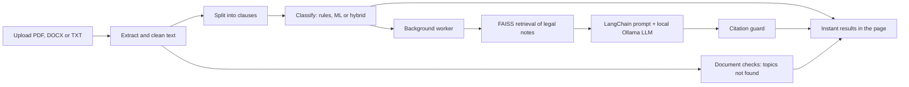

# InClause

[](https://github.com/rushalipattnaik/InClause/actions/workflows/ci.yml)


*Understand every clause before you sign.*

InClause reads a contract, lease or agreement (PDF, DOCX or TXT), splits it into clauses, flags the risky
ones, shows *why* each was flagged, and explains them using a **local LLM with retrieval-augmented generation**.
It also lists topics a document of that type normally covers but this one never mentions.
**Your document never leaves your computer.**

## Why it exists

Contracts are sensitive, so sending them to a hosted AI service is a poor trade for most people. InClause runs the
language model, the embedding model and the vector search entirely on your own machine. After setup it works offline.

## Features

- **Long documents.** Clauses are flagged instantly; explanations stream in afterwards, most serious first.
- **Three risk levels** (Safe, Risky, Suspicious), each with the exact words that triggered it, written from the
  point of view of the person signing (tenant, employee, customer, borrower).
- **Three classifiers you can compare:** keyword rules (default), an embedding-based logistic regression, and a hybrid.
  Pick one using the evaluation harness, not by guessing (see [docs/EVALUATION.md](docs/EVALUATION.md)).
- **Grounded explanations.** FAISS retrieves matching legal notes; a LangChain chain passes them to a local Ollama model.
  A citation guard removes any sentence that cites a law or section that is not in the clause or the retrieved notes.
- **Missing-topic check.** For rental, employment, loan and terms-of-service documents, lists standard topics that
  have no matching words in the text, so you know what to look for by hand.
- **Interface.** Drag-and-drop upload, risk summary bar, filters with counts, search, light and dark themes,
  a bundled sample lease, Markdown report download and print.
- **Private by design.** Runs on localhost, nothing is written to disk, results live in memory and are wiped on
  Clear or after 30 minutes, and the page makes no external requests.

## How it works



| Piece | Tool |
|---|---|
| Embeddings | HuggingFace `all-MiniLM-L6-v2`, run locally |
| Vector search | FAISS, inner product on unit vectors (a score is a cosine similarity) |
| Orchestration | LangChain (`ChatPromptTemplate`, `ChatOllama`, `StrOutputParser`) |
| LLM | Ollama, default `llama3.2:3b` |
| Classifiers | Regex rules; scikit-learn `LogisticRegression` on embeddings; a hybrid of the two |
| Web | Flask and Gunicorn, vanilla HTML, CSS and JS |

## Run it

### Option A: Docker
```
git clone https://github.com/rushalipattnaik/InClause.git
cd InClause
docker compose up --build
```
Open http://localhost:8000. The first run downloads several GB once. Wait for the `model-puller` container to
finish before your first upload. The embedding model and index are baked into the image and the container runs
with `HF_HUB_OFFLINE=1`.

### Option B: without Docker
```
ollama pull llama3.2:3b
python -m venv venv
venv\Scripts\Activate.ps1          # macOS and Linux: source venv/bin/activate
pip install -r requirements.txt
copy .env.example .env             # macOS and Linux: cp .env.example .env
python app.py                      # http://localhost:5000
```
The first request downloads the roughly 90 MB embedding model once.

Click **Try a sample** to see it work without a document of your own.

## Measuring accuracy

Accuracy needs a correct answer for each clause, and only a person can supply that. InClause keeps this to two steps:

```
python -m eval.label my_contract.pdf --count 50   # 1. press s, r or x for each clause (about 15 minutes)
python -m eval.full_report                         # 2. writes docs/RESULTS.md in plain language
```
Step 1 never shows the tool's own answer, so the score stays honest. Add `--suggest --model mistral` to get a local-AI
suggestion you can accept with Enter. That is faster, and every accepted suggestion is recorded and reported.

`CLASSIFIER=rules` (default) is instant and fully explainable. `ml` and `hybrid` use a model trained on the labelled
clauses in `eval/`. The report says whether either beats the rules on your clauses, and only then should you switch.
Details are in [docs/EVALUATION.md](docs/EVALUATION.md).

## Configuration (`.env`)

| Variable | Default | Meaning |
|---|---|---|
| `OLLAMA_MODEL` | `llama3.2:3b` | Any model from the Ollama library |
| `OLLAMA_BASE_URL` | `http://127.0.0.1:11434` | Where Ollama listens |
| `CLASSIFIER` | `rules` | `rules`, `ml` or `hybrid` |
| `HYBRID_FLAG_MIN` | `0.60` | Hybrid: model confidence needed to flag a clause the rules passed |
| `HYBRID_SAFE_MIN` | `0.70` | Hybrid: model confidence needed to clear a weak rule flag |
| `RAG_MIN_SIMILARITY` | `0.40` | Minimum cosine similarity for a note to be shown |
| `RAG_MARGIN` | `0.15` | A note must score within this distance of the best match |
| `RAG_TOP_K` | `2` | Notes per clause |
| `MAX_CLAUSES` | `500` | Safety ceiling per document |
| `MAX_UPLOAD_MB` | `15` | Upload size limit |
| `JOB_TTL_SECONDS` | `1800` | How long results stay in memory |

## Project layout

```
app.py                  Flask routes
utils/
  extractor.py          PDF, DOCX and TXT text extraction
  text_cleanup.py       ligature normalisation and glued-word repair
  clause_splitter.py    wrapped lines, numbering, headings, templates
  classifier.py         explainable regex rules
  ml_classifier.py      embeddings + logistic regression, hybrid combiner
  analysis.py           picks rules, ml or hybrid
  rag_engine.py         FAISS index, cosine scores, threshold and margin
  summarizer.py         LangChain chain, preamble stripping, citation guard
  doc_checks.py         document type and missing-topic checks
  jobs.py               in-memory job queue and report builder
legal_data/             knowledge base with a reviewed flag per note
eval/                   labelled data, labelling tool, evaluation, one-command report
tests/                  unit and API tests
docs/                   design decisions, evaluation, knowledge base review
```

## Tests and CI
```
pip install -r requirements-dev.txt
ruff check .
python -m pytest -q          # no model downloads needed
```
GitHub Actions runs the linter, the tests and the evaluation plumbing on every push.

## Limitations

- Risk flags from the rules are keyword matches. They are tuned for the signer's point of view and miss anything subtle.
- A clause is judged on its own. Contradictions or double charges across clauses are not detected.
- Small local models can explain a clause wrongly. Treat explanations as a reading aid.
- The legal notes are short summaries. Each is labelled "not yet reviewed" until checked (see
  [docs/KNOWLEDGE_BASE_REVIEW.md](docs/KNOWLEDGE_BASE_REVIEW.md)).
- Scanned PDFs need OCR, which is not supported. One user at a time per machine.
- Repairing words glued together by PDF extraction is a heuristic.

## Disclaimer
General, AI-generated information for education only. Not legal advice.

## License
MIT. See [LICENSE](LICENSE).
